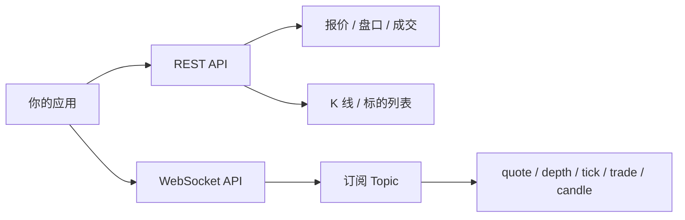

> [中文](./README.md) | [English](./README_en.md)

# DeepTick · 实时金融行情数据 API

[](https://github.com/deep-tick/deeptick-realtime-market-data-api/stargazers)
[](https://github.com/deep-tick/deeptick-realtime-market-data-api/network/members)
[](./Deeptick行情API文档.md)

通过 REST 与 WebSocket 接入股票、外汇、加密货币、贵金属和指数行情。适合看板、策略信号和行情查询。

**官网：** https://www.deeptick.cc  
**接口文档：** [Deeptick行情API文档.md](./Deeptick行情API文档.md)（v3.8）

---

## 两种接入

| | REST | WebSocket |
| --- | --- | --- |
| 地址 | `https://api.deeptick.cc` | `wss://api.deeptick.cc/ws/v1` |
| 适用 | 快照、历史 K 线、标的检索 | 实时报价、盘口、逐笔、K 线推送 |
| 认证 | 请求头 `deeptoken` | 握手头 `deeptoken`；浏览器放查询参数 |

API Key 在 [控制台](https://www.deeptick.cc) 创建，REST 和 WebSocket 用同一把钥匙。`GET /api/v1/time` 免鉴权，可用来确认网关是否可达。



---

## 支持的市场

标的在 REST 里写成 `{代码}.{市场}`，例如 `BTCUSDT.CR`。WebSocket Topic 写成 `{类型}.{市场}.{代码}`，例如 `quote.CR.BTCUSDT`。可交易标的以 `GET /api/v1/symbols` 为准。

| 市场码 | 品种 | REST 示例 | Topic 示例 |
| --- | --- | --- | --- |
| `CR` | 加密货币 | `BTCUSDT.CR` | `quote.CR.BTCUSDT` |
| `FX` | 外汇 | `EURUSD.FX` | `quote.FX.EURUSD` |
| `CN` | A 股 | `600519.SH` | `candle.CN.600519.SH.1m` |
| `HK` | 港股 | `00700.HK` | `tick.HK.00700` |
| `US` | 美股 | `AAPL.US` | `depth.US.AAPL` |
| `MT` | 贵金属 | `XAUUSD.MT` | `quote.MT.XAUUSD` |
| `IDX` | 指数 | `SPX.IDX` | `quote.IDX.SPX` |

---

## 数据接口

### REST

| 方法 | 作用 |
| --- | --- |
| `GET /api/v1/time` | 服务器时间，免鉴权 |
| `GET /api/v1/quote?symbols=` | 实时报价，一次 1 个标的 |
| `GET /api/v1/orderbook?symbol=` | 盘口 |
| `GET /api/v1/trades?symbol=&limit=` | 最近成交 |
| `GET /api/v1/candles?symbols=&interval=&limit=` | K 线，周期 `1m` `5m` `15m` `30m` `60m` `4h` `1d` `1w` `1M` |
| `GET /api/v1/symbols` | 按市场检索标的 |

成功响应为 `{"code":0,"msg":"ok","data":...}`。

### WebSocket

连接后先收到 `welcome`，再发送订阅。建议每 30 秒发一次 `ping`，否则约 60 秒无上行会被断开。

```json
{"type":"subscribe","topics":["quote.CR.BTCUSDT","depth.US.AAPL","candle.CN.600519.SH.1m"],"request_id":"r1"}
```

| Topic 类型 | 含义 |
| --- | --- |
| `quote` | 实时报价 |
| `depth` | 盘口 |
| `tick` | 逐笔 |
| `trade` | 成交推送 |
| `candle` | K 线，末段为周期 |

---

## 快速开始

1. 在 https://www.deeptick.cc 注册并复制 API Key。
2. 设置环境变量 `DEEPTICK_TOKEN`。
3. 跑一个示例，或直接请求报价。

```bash
# Windows PowerShell
$env:DEEPTICK_TOKEN = "your_api_key"

# macOS / Linux
export DEEPTICK_TOKEN=your_api_key
```

```python
import os, json, urllib.request

token = os.environ.get("DEEPTICK_TOKEN", "your_api_key")
req = urllib.request.Request(
    "https://api.deeptick.cc/api/v1/quote?symbols=BTCUSDT.CR",
    headers={"deeptoken": token},
)
print(json.load(urllib.request.urlopen(req)))
```

WebSocket 订阅见 [examples/python/websocket_example.py](./examples/python/websocket_example.py)。

---

## 代码示例

每种语言各有一份 REST 脚本和一份 WebSocket 脚本，说明见 [examples/README.md](./examples/README.md)。

| 语言 | REST | WebSocket |
| --- | --- | --- |
| Python | [rest_example.py](./examples/python/rest_example.py) | [websocket_example.py](./examples/python/websocket_example.py) |
| Java 11+ | [RestExample.java](./examples/java/RestExample.java) | [WebSocketExample.java](./examples/java/WebSocketExample.java) |
| Go | [go/rest](./examples/go/rest) | [go/ws](./examples/go/ws) |
| PHP | [rest_example.php](./examples/php/rest_example.php) | [websocket_example.php](./examples/php/websocket_example.php) |
| Node.js | [rest_example.mjs](./examples/nodejs/rest_example.mjs) | [websocket_example.mjs](./examples/nodejs/websocket_example.mjs) |

```bash
pip install -r examples/python/requirements.txt
python examples/python/rest_example.py
python examples/python/websocket_example.py
```

---

## 仓库文件

| 文件 | 内容 |
| --- | --- |
| [Deeptick行情API文档.md](./Deeptick行情API文档.md) | 字段、错误码、限流与订阅规则 |
| [examples](./examples) | Python、Java、Go、PHP、Node.js 示例 |
| [README_en.md](./README_en.md) | English overview |

对客契约以文档第 1–8 章和官网控制台为准。

---

## 常见问题

**REST 和 WebSocket 怎么选？**  
查一次快照或历史 K 线用 REST。看板和策略要持续收行情用 WebSocket。

**钥匙放哪里？**  
请求头或握手头的名字都是 `deeptoken`，值是控制台复制的整串。浏览器不能自定义握手头时，把同一串放在 `?deeptoken=`。

**为什么返回 1001？**  
钥匙缺失、为空或无效。确认环境变量 `DEEPTICK_TOKEN` 已设置，且没有多传标的。报价接口一次只能查 1 个代码，多个代码返回 `8005`。

**有没有调用频率限制？**  
有。额度按套餐计算，超限会返回限流错误码。细节见文档第 7 章。

---

## 链接

- 官网：https://www.deeptick.cc
- 本仓库：https://github.com/deep-tick/deeptick-realtime-market-data-api
